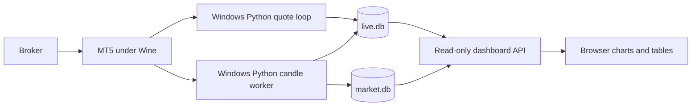

# Gateway architecture

## Data flow

The MetaTrader5 Python package talks locally to the terminal through IPC. There
is no REST broker bridge here. The unrelated `mt5-gateway` container on this
laptop is not part of this data path.

## Core container lifecycle

1. `entrypoint.sh` starts Xvfb, Openbox, x11vnc, and noVNC/websockify.
2. With fresh state it copies the image's executable into `/state/terminal`
   and prepares Windows Python in `/state/python`.
3. The first start downloads pinned MT5/NumPy packages. A marker records setup;
   a fresh volume therefore still needs internet access to PyPI.
4. Live mode uses `LIVE_MAX_BARS` as the terminal chart limit. The Linux Python
   helper updates persistent `common.ini`, preserving unrelated settings, and
   a startup INI also supplies that limit.
5. MT5 starts in portable mode. `container_runner.py` authenticates using the
   environment, waits for broker connectivity, and checks the chart limit.
6. Live mode runs `live_collector.py` in the authenticated Python process. It
   spawns another Windows Python process for candle collection.

Keeping the initial SDK connection avoids a previous IPC disconnect/reconnect
handoff failure. The candle process has its own SDK connection. Separate
processes isolate Python loops, but both depend on the same MT5 terminal;
terminal-side synchronization can still delay prices during cold starts.

## Live collection

Quotes come from `symbol_info_tick()`. Bid/ask must be finite, positive, and
ordered. Spread is ask minus bid; spread points use the instrument's point.
Changing tick timestamps indicate new observations; polling alone does not
manufacture a new tick when the market is quiet.

The quote loop measures cycle duration, aggregate MT5 polling time, batched
SQLite quote-upsert time, maximum local receipt age within the cycle, and poll
interval overruns in `collector_status`. Quote API responses separately expose
age since local receipt and broker timestamp skew; this avoids treating a broker
clock offset as delivery latency. MT5 calls are collected before acquiring the
SQLite write transaction, then the latest quotes are upserted in one batch.

Candles come from `copy_rates_from_pos()`, upserted by symbol/timeframe/time.
Overlapping recent bars update the forming candle and persist the previous
candle's final values. Per-symbol writes are batched after MT5 calls complete,
so database write locks are not held while waiting for the terminal.

Short candles target the base interval. Longer ones use
`min(60, max(base_interval, period_seconds / 120))` seconds. Each history request
yields 50 ms so quote IPC has an opportunity to run. Intervals are scheduling
targets, not real-time guarantees.

New empty series start with two candles. Request depth grows fourfold toward
`LIVE_SEED_BARS`, with the next depth persisted in `seed_progress`. A restart
can resume this work. Outage catch-up is limited by `LIVE_MAX_BARS`;
`catchup_limited` records the latest refresh result per series. Monthly catch-up uses
calendar months rather than a fixed 30-day approximation.

The quote process supervises the candle worker and restarts it with bounded
exponential backoff. SIGTERM/SIGINT trigger worker termination, SQLite close,
and MT5 shutdown. Per-series bounds, recent bar count and detected gaps (bounded
to the last 10,000 bars), and unavailable refresh count are refreshed in
`candle_status`. `MT5_TIME_OFFSET_SECONDS` can subtract a
verified broker timestamp offset from newly stored quote/candle times; default
is zero and existing rows are unchanged.

## Dashboard

Python's standard-library `ThreadingHTTPServer` serves buildless HTML/CSS/JS.
There is no Node runtime, chart CDN, or broker credential in this container.
Canvas draws OHLC candles and tick volume. The browser calls GET-only APIs.

SQLite connections use `mode=ro` and `PRAGMA query_only=ON`; Docker also mounts
the data volume read-only. The service runs as UID 1001. Arbitrary SQL and write
APIs are absent. Busy or timed-out database requests return HTTP 503.
Optional Basic authentication is enabled when both `DASHBOARD_USER` and
`DASHBOARD_PASSWORD` are set; remote access still requires HTTPS or SSH.

Live display polls every second while visible/enabled. Candle refresh and
coverage refresh are separate. History-range overviews refresh on selection or
explicit user request instead of repeatedly running expensive aggregation.

## Images and dependencies

| Component | Current setup |
| --- | --- |
| Core image | `mt5scraper:local`, Linux/amd64, Ubuntu 24.04 |
| Windows compatibility | WineHQ staging; locally tested with 11.20 |
| Windows Python | Embeddable Python 3.12.10 |
| SDK / NumPy | MetaTrader5 5.0.6231 / NumPy 1.26.4 |
| Dashboard image | `mt5scraper-dashboard:local`, `python:3.12-slim` |
| Core caps | 4 CPU, 4 GiB, 512 PIDs |
| Dashboard caps | 0.25 CPU, 256 MiB, 64 PIDs |

Memory-plus-swap equals memory, so neither service has additional swap. Apt/base
image tags are not fully pinned to immutable digests. MT5 can auto-update in
state; a rebuilt seed executable does not replace an existing state terminal.

## Modes

| MT5_MODE | Behavior |
| --- | --- |
| `live` | Continuous quotes and candles; current default |
| `stack` | Historical batch job, then keep terminal running |
| `scrape` | Historical batch job, then exit |
| `check` | Authenticate/check connectivity, then exit |
| `desktop` | Terminal/desktop; authenticate when credentials are supplied |

Server Compose still passes historical CLI arguments. Live mode ignores those;
configure it with the `LIVE_*` settings.
